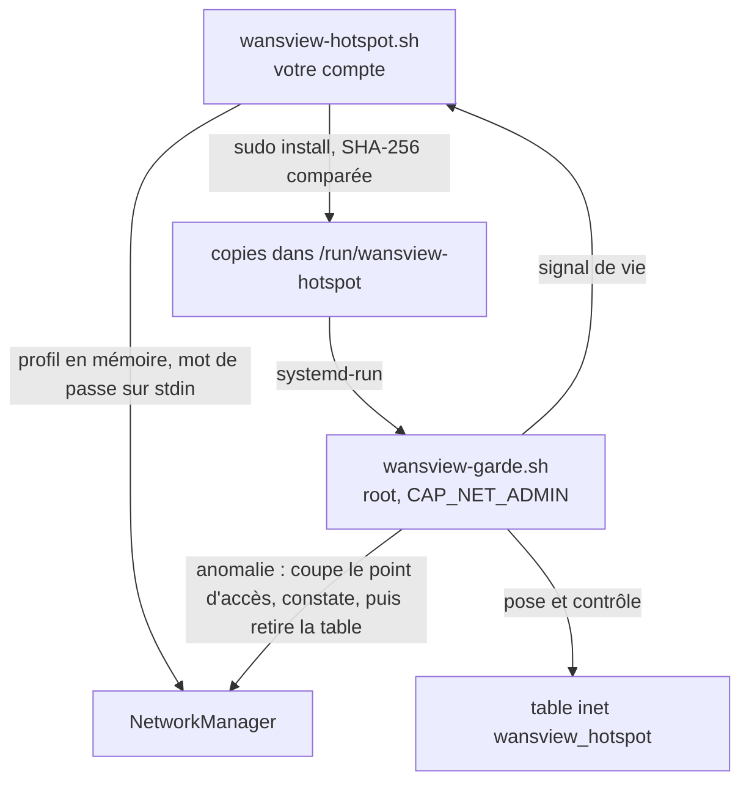

# wansview-hotspot

Transforme temporairement le Wi-Fi d'un portable Ubuntu en point d'accès 2,4 GHz, avec Internet par l'Ethernet, pour configurer puis utiliser une caméra IP Wansview Q5. Tout est annulé à l'arrêt. Version 0.1.0.

> **Avant d'utiliser cet outil :** sur un réseau d'établissement scolaire ou d'entreprise, un point d'accès personnel peut être interdit. Demandez l'autorisation.

> **État de validation :** le code est testé avec des commandes simulées. L'isolation n'est **pas prouvée** tant que le test en espace de noms réseau et la vérification sur la vraie machine n'ont pas réussi.

## Prérequis

Ubuntu avec NetworkManager et nftables. Commandes utilisées : `nmcli`, `iw`, `ip`, `nft`, `flock`, `dnsmasq` (paquet `dnsmasq-base`), `sudo`, `systemd-run`, `systemctl`. `python3` pour la découverte ONVIF, `nc` pour la vérification. Rien n'est installé automatiquement.

Il faut :

- une connexion Ethernet active qui porte la route vers Internet ;
- une carte Wi-Fi gérée par NetworkManager, avec mode point d'accès et bande 2,4 GHz.

## Utilisation

Depuis la racine du dépôt, **avec votre compte** (jamais `sudo` devant le script, il le demande lui-même) :

```bash
tools/wansview-hotspot/wansview-hotspot.sh start
```

Le script demande le mot de passe du point d'accès, puis reste au premier plan. `Ctrl+C` arrête et restaure.

```bash
tools/wansview-hotspot/wansview-hotspot.sh status
```

```bash
tools/wansview-hotspot/wansview-hotspot.sh stop
```

| Option de `start` | Défaut | Rôle |
|---|---|---|
| `--ssid NOM` | `Wansview-Setup` | Lettres, chiffres, espace, `_`, `.`, `-` (32 au plus) |
| `--channel N` | `6` | Canal 2,4 GHz autorisé par la carte (en général 1 à 11) |
| `--wifi-iface NOM` | détectée | Obligatoire s'il y a plusieurs cartes utilisables |
| `--eth-iface NOM` | détectée | Carte qui doit porter la route Internet |

Mot de passe : 8 à 63 caractères ASCII imprimables, sans espace au début ni à la fin, sans `\`. Il n'est ni affiché, ni journalisé, ni écrit dans un fichier, ni passé en argument.

Réseau du point d'accès : PC en `10.42.0.1/24`, DHCP de `10.42.0.10` à `10.42.0.100`.

## Première mise en service

Faites ces étapes dans l'ordre. Elles seules prouvent que tout fonctionne chez vous.

1. Tests sans aucun droit particulier :

```bash
tools/wansview-hotspot/tests/run-tests.sh
```

2. Vraies règles nftables dans un réseau jetable, sans toucher à votre connexion :

```bash
sudo unshare --net bash tools/wansview-hotspot/tests/isolation-netns.sh
```

3. Relevé avant démarrage (Ethernet branché) :

```bash
tools/wansview-hotspot/tests/verification-reelle.sh avant
```

4. `start` dans un premier terminal, puis dans un second (remplacez l'adresse par celle de la caméra, donnée par `status`) :

```bash
tools/wansview-hotspot/tests/verification-reelle.sh pendant --camera 10.42.0.10
```

Suivez la liste de contrôle affichée, avec un téléphone connecté au point d'accès.

5. `stop`, puis :

```bash
tools/wansview-hotspot/tests/verification-reelle.sh apres
```

## Caméra Wansview Q5

1. Lancez `start`, puis configurez la caméra dans l'application Wansview Cloud avec le SSID et le mot de passe du point d'accès (téléphone connecté à ce réseau).
2. `status` liste les appareils connectés et leur adresse.
3. Découverte ONVIF, depuis l'adresse du point d'accès :

```bash
python3 tools/wansview-hotspot/outils/decouverte-onvif.py --source 10.42.0.1
```

4. Flux vidéo, **en TCP** : renseignez `CAMERA_RTSP_URL` dans `.env` (modèle : `.env.example`, flux `/live/ch0`, port selon le réglage de la caméra), chargez-la dans votre shell, puis lancez `ffplay -rtsp_transport tcp "$CAMERA_RTSP_URL"`. Les identifiants ne vont jamais dans le dépôt.

La caméra perd le réseau à l'arrêt. Réutilisez ensuite le même SSID et le même mot de passe pour qu'elle se reconnecte.

## Fonctionnement



1. Vérifications. Au moindre défaut, rien n'est modifié.
2. Sauvegarde de l'état du Wi-Fi, puis profil temporaire (`save no`, `autoconnect=no`). Contrôle que rien n'est écrit dans `/etc/netplan` ni dans `/etc/NetworkManager/system-connections`.
3. Installation et lancement du garde (`sudo`), puis seulement déconnexion du Wi-Fi.
4. Le point d'accès n'est activé qu'après confirmation de l'isolation. Il n'existe pas de mode sans isolation.
5. Contrôle toutes les 2 s des deux côtés.

Le garde arrête tout si le script principal disparaît, si la table est modifiée, si les réseaux de l'Ethernet changent (câble débranché compris) ou si le point d'accès n'est pas activé dans les 60 s.

## Isolation

| Trafic | Décision |
|---|---|
| Client vers PC : DHCP, DNS sur `10.42.0.1` | autorisé |
| Client vers PC : toute autre nouvelle connexion (SSH, RPC, ping…) | bloqué |
| PC vers client, et réponses | autorisé |
| Client vers Internet par l'Ethernet | autorisé |
| Client vers réseaux privés ou réservés, `100.64.0.0/10`, sous-réseaux de l'Ethernet | bloqué |
| Client vers Tailscale, Docker, libvirt ou toute autre interface | bloqué |
| Réseau Ethernet vers client (nouvelle connexion) | bloqué |
| IPv6 entrant ou transféré depuis ou vers le Wi-Fi | bloqué |

Seule la table `inet wansview_hotspot`, marquée du commentaire `wansview-hotspot`, est créée et supprimée. Les autres règles du système ne sont pas modifiées par le projet. NetworkManager ajoute et retire lui-même ses règles de partage de connexion.

Les réponses à la découverte WS-Discovery sont admises pendant 10 s, uniquement vers le port du PC qui a émis la sonde.

## Ce qui est écrit

| Emplacement | Contenu |
|---|---|
| `$XDG_RUNTIME_DIR/wansview-hotspot/` | État de session (privé), effacé à la restauration ; fichier de verrou |
| `~/.local/state/wansview-hotspot/` | Journal sans secret, relevés de vérification |
| `/run/wansview-hotspot/` | Copies du garde et signal de vie (disparaît au redémarrage) |

Rien dans `/etc`.

## En cas de problème

Lancez d'abord `stop` : il restaure après un arrêt brutal et supprime les restes (profil, service, table).

Journal du garde :

```bash
journalctl -u wansview-hotspot-garde
```

Si `stop` échoue, à la main et **dans cet ordre** (les règles ne se retirent qu'une fois le point d'accès coupé) :

```bash
nmcli connection delete wansview-hotspot-tmp
```

```bash
sudo systemctl stop wansview-hotspot-garde
```

```bash
sudo nft delete table inet wansview_hotspot
```

Un redémarrage efface aussi tout : profil en mémoire, service temporaire, règles et fichiers dans `/run`.

| Code de sortie | Sens |
|---|---|
| 2 | Option ou valeur invalide |
| 3 | Condition de démarrage non remplie |
| 4 | Lancé en root |
| 5 | Déjà en cours, ou restes à nettoyer avec `stop` |
| 6 | Profil impossible à créer |
| 7 | Écriture détectée dans la configuration permanente |
| 8 | Isolation impossible à garantir |
| 9 | Activation impossible |
| 10 | Restauration incomplète |

## Limites

- **Les appareils connectés au point d'accès communiquent entre eux.** Ce trafic est relayé par le pilote Wi-Fi, nftables ne le voit pas. L'ARP n'est pas filtré.
- La protection des trames de gestion (PMF) est **désactivée** pour la compatibilité avec la caméra.
- Le ping vers `10.42.0.1` est bloqué. Si la caméra refuse de se connecter, c'est un suspect.
- Après une altération des règles, une fenêtre d'environ 2 s existe avant la réaction. Seule la table du projet est surveillée.
- Internet n'est pas filtré. Une machine locale à adresse publique, hors des sous-réseaux connus de l'Ethernet, reste joignable.
- Le DNS local permet aux clients de résoudre des noms internes, sans accès aux machines privées.
- RTSP garanti en TCP ; en RTP sur UDP, le flux peut être bloqué.
- ONVIF : les notifications poussées par la caméra vers le PC et ses annonces `Hello` sont bloquées.
- Un conteneur Docker en réseau « bridge » ne peut pas joindre la caméra. Pour MediaMTX en conteneur, utilisez `network_mode: host` ou prévoyez une règle dédiée.
- Si le script principal est tué (`SIGKILL`), le garde coupe le point d'accès, mais le Wi-Fi n'est entièrement restauré qu'avec `stop`.
- Quiconque peut modifier les fichiers du projet peut faire exécuter du code en root au prochain `start`.

### Non vérifié en conditions réelles

- La syntaxe et l'effet des règles nftables (étape 2 ci-dessus).
- Le durcissement systemd du garde (`CapabilityBoundingSet`, `ProtectSystem`…).
- La reconnexion d'un client sans nouvelle demande de mot de passe (`psk-flags 2`). Si NetworkManager le redemande, il faudra conserver le secret dans le profil en mémoire.

## Développement

```
wansview-hotspot.sh    commandes start, status, stop
wansview-garde.sh      garde exécuté en root
lib/                   validation, détection, règles, état, point d'accès, restauration
outils/                découverte ONVIF
tests/unit/            tests (Bash et unittest)
tests/faux/            fausses commandes réseau
```

`tests/run-tests.sh [motif]` n'exécute que des commandes simulées : le `PATH` des tests ne contient aucun outil réseau réel et le bus système est rendu injoignable. Les variables `WH_TEST_*` ne sont prises en compte que pour un utilisateur non root avec `WH_MODE_TEST=1`. ShellCheck est lancé s'il est installé.
